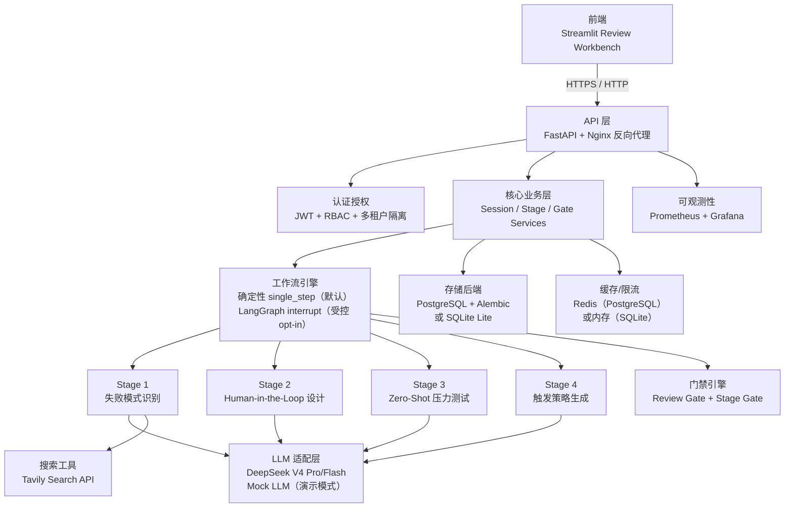
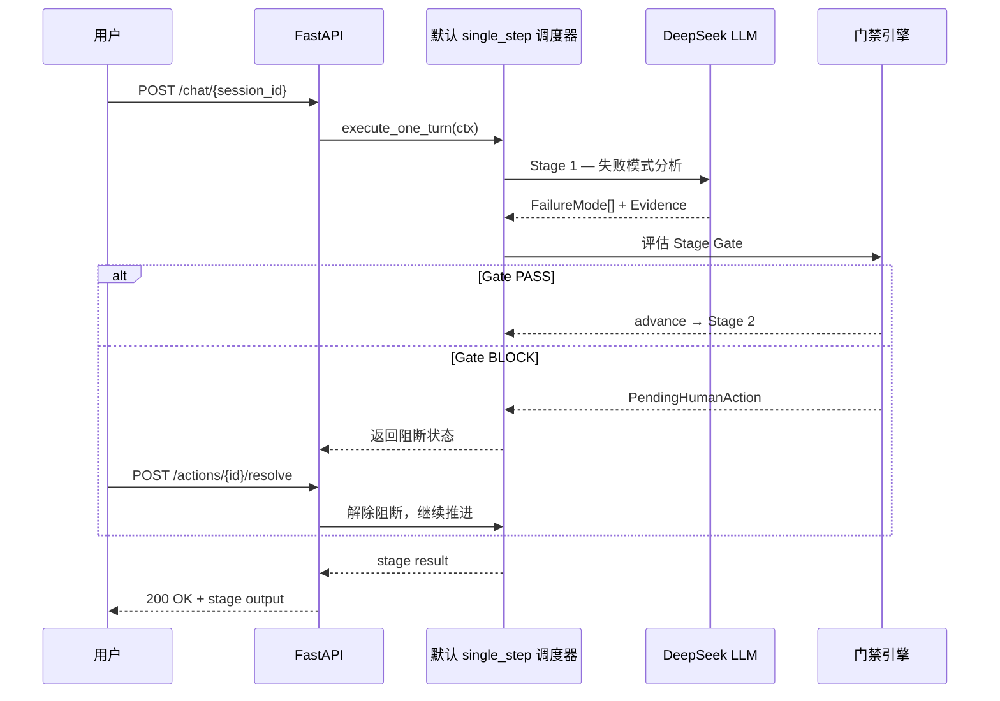

# Architecture

> Status: Implemented

This project is an AI Workflow Pre-mortem & Human Oversight Tool, not a general workflow builder.

---

## 系统架构总览



### 前端分层（Streamlit）

`frontend/app.py` 只做入口装配：`st.set_page_config` → 认证守卫 → 状态初始化 → `st.navigation` 双页面（会话工作台 / 治理总览）→ `pages.run()`。业务代码按 MVC 分层：`frontend/models/`（环境配置、认证令牌、API 客户端、StageOperation 状态投影、展示映射表）、`frontend/controllers/`（auth / session / stage / governance / eval / report 六个业务域动作编排）、`frontend/views/`（`pages.py` 装配页面、侧栏、工作台、实时监督与各业务面板），`frontend/components/` 为可复用视图组件。依赖方向固定为 `models ← controllers ← views ← app.py`；状态转换仍由后端服务与门禁引擎决定，前端只负责协议适配、状态投影与渲染。

---

## 四阶段工作流时序



---

## Runtime Path

Current request execution flows through `SessionService` and the execution-mode coordinator before entering the graph runner:

```text
FastAPI / Streamlit
-> SessionService
-> core.execution_service.execute_one_turn(ctx)
   -> single_step
      -> graph.runner.run_one_step(ctx)
   -> langgraph_interrupt guarded opt-in mode
      -> graph.langgraph_interrupt_runner.invoke_one_turn_with_interrupts(ctx)
-> graph.nodes
-> StageExecutor
-> Review Gate
-> PendingHumanAction / SafetyFinding / EvidenceSource / EvalCase / EvalRun
-> PostgreSQL + Redis cache，或 SQLite + MemoryCache
```

`single_step` remains the default stable path. `langgraph_interrupt` is a guarded opt-in path selected only through `WORKFLOW_EXECUTION_MODE=langgraph_interrupt`.

The interrupt path uses a fail-closed runtime contract:

- PostgreSQL business storage requires `CHECKPOINT_BACKEND=postgres`, an independent `CHECKPOINT_ENCRYPTION_KEY`, and `UVICORN_WORKERS=1`.
- Checkpoint schema changes are owned by Alembic; runtime initialization validates the schema and must not create tables ad hoc.
- A PostgreSQL checkpoint initialization or health failure makes the service unready; it must not fall back to an in-memory saver.
- `CHECKPOINT_BACKEND=memory` is restricted to SQLite/local development. It is non-persistent and cannot recover an interrupt after process restart.
- Checkpoint payload encryption is separate from business-field encryption. `CHECKPOINT_ENCRYPTION_KEY` and `DATA_ENCRYPTION_KEY` have different key lifecycles and must not share values.

## Domain Boundaries (v1.5.0)

`SessionService` remains the compatibility facade for API and frontend callers. Internally it delegates to five lifecycle domains:

```text
api/routers
-> core/session_service.py (SessionAccess + thin facade)
   -> core/services/session_workflow.py   Session / Workflow
   -> core/services/governance.py         Governance / Review / Gate
   -> core/services/evidence.py           Evidence
   -> core/services/evaluation.py         Evaluation / Redteam
   -> core/services/audit_trace.py        Audit / Trace
```

Dependency rules:

- Domain services only read/write `ProjectContext`; storage and cache access is shared through `SessionAccess`, which deliberately reads the globals from `core/session_service.py` so existing test patch points keep working.
- Domain services never import each other or `core/session_service.py` at module scope; cross-domain effects are orchestrated explicitly by the facade or `core/governance/action_effects.py`.
- `core/risk/*` and `core/coverage/*` are pure domain modules. `core/gates/*` may depend on them, never the reverse.
- Human-action creation, resolution state machine, and cross-domain effects live in `core/governance/{action_factory,action_resolution,action_effects}.py`; `core/oversight_service.py` is a compatibility re-export surface only.

## Deterministic Risk Model (v1.5.0)

Project risk is derived from six structured factors, each on a 0–3 ordinal scale: `impact`, `autonomy`, `data_sensitivity`, `reversibility`, `scale`, `external_exposure`.

- Input priority: explicit human factors (`ProjectContext.risk_profile`), scenario-manifest factors, then a deterministic legacy inference adapter for old sessions. Keyword banks are only used by the legacy adapter; they no longer decide the tier directly.
- Aggregation: weighted score (`impact=3, autonomy=4, data_sensitivity=2, reversibility=2, scale=1, external_exposure=2`) with fixed score bands (LOW 0–4, MEDIUM 5–14, HIGH 15–21, CRITICAL 22–42) plus hard floors (for example `sensitive_personal` → at least HIGH, severe impact with autonomous action → CRITICAL).
- LLM output may only supply explanatory text (`llm_explanation`); it never changes the tier.
- Human override is append-only: original tier, requested tier, effective tier, floor tier, reason, actor, role, tenant and audit event are recorded. Downgrades require admin and are clamped to the deterministic floor.
- `core/gates/risk_profile.py` is a compatibility import surface for `core.risk`.

## Risk-Driven Stage 3 Coverage (v1.5.0)

`core/coverage/policy.py` is the single source of truth for high-risk workflow nodes and Stage 3 node selection.

- LOW requires coverage for nodes addressing `critical` failure modes; MEDIUM/HIGH/CRITICAL require nodes addressing `high` or `critical` failure modes.
- HIGH/CRITICAL always select every required high-risk node regardless of budget; CRITICAL selects every workflow node.
- LOW/MEDIUM/HIGH non-required nodes are sampled with `budget = max(configured_sample, ceil(min_coverage_ratio * total_nodes))` (HIGH/Critical required nodes are never truncated).
- The Stage 3 gate enforces `STAGE3_MIN_CASES_PER_HIGH_RISK_NODE` (default 1) for each required node; LOW/MEDIUM keep the historical minimum of 1.
- The same high-risk node definition is shared by Stage 3 selection, the `stage3_eval_failure` gate, readiness coverage warnings, Redteam coverage, and eval summaries.

## Workflow State Fail-Closed

未知或非法 `current_state` 不允许自动回退到 `INIT`：

- 运行路径：`graph.runner.run_one_step` 与 `core.execution_service.execute_one_turn` 在进入节点前调用 `core.workflow_state_service.assert_advanceable`；未知状态由 `mark_invalid_state` 改写为 `RECOVERY_REQUIRED`，不执行任何节点。
- 存储路径：PostgreSQL 与 SQLite 后端的 `load()` 先经 `sanitize_persisted_state`，把旧版本或人工改库留下的未知状态改写为 `RECOVERY_REQUIRED` 并保留原始值到 `last_error`。
- 阻断态：`ERROR` / `RECOVERY_REQUIRED` 下任何推进入口抛 `WorkflowBlockedError`，API 返回 409；唯一出口是 `POST /sessions/{session_id}/workflow/recover`，目标状态必须属于 `RESUMABLE_STATES`，恢复动作写 `workflow_recovered` 审计事件。
- 确定性：判定只依赖当前状态值，不调用 LLM、不读取外部服务。

## Review and Action Resolution Path

Human review actions are resolved through service-layer coordination rather than by support modules advancing stages directly:

```text
FastAPI / Streamlit
-> SessionService (orchestration layer)
-> core.oversight_service.resolve_action(...)
   -> assert_action_resolution_allowed -> graph.transition_policy.evaluate_action_resolution(...)
-> SessionService.after_human_resolution -> stage_advancement_coordinator
   -> core.execution_service.sync_execution_after_action_resolutions(...)   # 复数：批量入口
      -> core.execution_service.sync_execution_after_action_resolution(...) # 单数：由批量入口内部逐条调用
      -> single_step: no checkpoint mutation
      -> langgraph_interrupt: mark interrupt resumed/cancelled and consume resume once
-> stage gate re-evaluation
```

Note: `SessionService` is the orchestrator — `oversight_service.resolve_action` validates and resolves the action (delegating the policy check to `transition_policy`), then `SessionService` triggers execution synchronization via the stage advancement coordinator. The three modules run in the order shown, but are not chained inside `oversight_service`.

Stage rerun, revise, rollback, and sync-review-actions are explicit stage operations under `core.stage_operation_service` and `api.routers.stage`.

## Core Principles

- Workflow transitions are deterministic and code-controlled.
- LLMs generate analysis, not autonomous workflow transitions.
- High-risk decisions require human review.
- Evidence, safety findings, eval cases, eval runs, interrupt records, and report artifacts are first-class records.
- Graph, API, frontend, and reports consume the same stage readiness contract.
- Full runtime validation is intentionally separate from dependency-light contract tests.

## Key coordination points

（自 v1.0.0 确立，v1.3.0 复核仍然有效）

- `core/version.py` is the version source of truth.
- `core/stage_readiness_service.py` is the authoritative stage gate source.
- `graph/transition_policy.py` keeps backward-compatible transition and action-resolution helpers.
- `core/stage_resolution_service.py` maps blockers to concrete next operations.
- `core/stage_operation_service.py` performs explicit non-runtime stage operations.
- `core/execution_service.py` centralizes execution-mode dispatch and interrupt synchronization.
- `FailureMode.evidence_ids` preserves structured evidence references.
- User materials are represented as `EvidenceSource(source_type="user_material")`.
- Eval coverage and high-risk eval review are part of the Stage 3 gate.
- `core/risk` is the deterministic six-factor risk authority; `core/gates/risk_profile.py` is a compatibility re-export.
- `core/coverage/policy.py` is the shared high-risk node / Stage 3 sampling authority.
- `core/session_service.py` is a compatibility facade over the five lifecycle domain services; domain services must not import each other or the facade at module scope.
- `core/gates/rules/manifest.py` is the authoritative source for gate rule metadata (owner / version / changelog / safety_bottom_line).
- `gate_evaluation_records` table (alembic V005) is the baseline data source for governance pass-rate trends. Its rows are projections of `sessions` and are deleted with the session on admin delete or retention purge; tenant backfill covers legacy NULL rows.
- LangGraph checkpoint tables are owned by Alembic V006; the durable resume outbox is owned by V007; V008 adds `sessions.version` (optimistic locking), JSONB generated columns for list/governance queries, tenant indexes and `human_actions.tenant_id`.
- The outbox is reconciled once on startup and then retried periodically by the in-process scheduler in `core/execution_service.py` (`INTERRUPT_RESUME_RETRY_INTERVAL_SECONDS`, default 600s, 0 = startup-only). The scheduler starts only in `langgraph_interrupt` mode and is stopped before the checkpoint runtime and pool close.
- `core/eval_llm_judge.py` is the authoritative implementation of LLM Judge (suggestion only, never overrides final judgment directly).


## Doc/Test/Core Alignment Contract

Stage readiness, resolution, and advancement-decision contracts are enforced through the service layer (`core/stage_readiness_service.py`, `core/stage_resolution_service.py`, `core/stage_advancement_decision.py`) and validated by dedicated tests in `tests/`.

Runtime validation requires the full dependency/service environment: FastAPI startup, Streamlit startup, Docker compose, PostgreSQL, Redis, Tavily, real LLM calls, and end-to-end workflow replay.

Governance bypass-write contract: writing `gate_evaluation_records` to the database is a side-path operation. If the write fails, the main gate evaluation path is not blocked and only a warning log is emitted. This means the governance trend data may be incomplete when storage errors occur.
